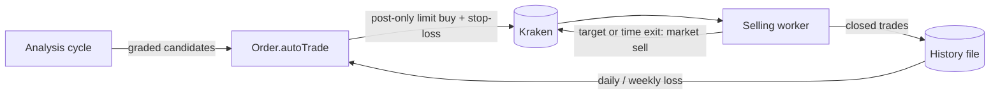

# Dalgon

Dalgon is a Node.js short-term trading bot for Kraken spot markets. It scans a small set of coins for dip-reversal setups, buys with a protective stop-loss already attached, exits at a target or time limit, enforces loss limits, and is controlled through Viber.

It buys a short-term dip and sells the rebound, risking a small fixed amount per trade. It does not predict the market. Backtests on 2022 to 2026 data found no profit in the original MACD/OBV signal, and only weak, unproven evidence for the optional capitulation signal: see [Backtesting](#backtesting) and [Limitations](#limitations).

## How it works



1. **Analyse.** Each cycle, `Analysis` reads OHLC candles for BTC and each configured asset at several horizons and looks for a MACD reversal with positive on-balance volume after a price drop.
2. **Filter.** Entries are blocked after a market-wide BTC drop, and candidates that already surged, are too volatile for the stop, or are illiquid are dropped.
3. **Rank.** Candidates are graded, and only those at or above `AUTOTRADE_GRADE_THRESHOLD` are considered, best first.
4. **Gate.** No entry if the daily or weekly loss limit is reached, the maximum number of positions is open, or Kraken's open orders cannot be read.
5. **Enter.** The position is sized so a stop-out costs at most `MAX_RISK_AMOUNT`. A post-only limit buy is submitted at the bid with an exchange-side stop-loss attached. An unfilled entry expires after `ENTRY_TIMEOUT_SECONDS`.
6. **Manage.** The selling worker checks open positions every 90 seconds, sells at market when the target or the maximum hold time is reached, and journals every closed trade.

### Entry signal

An asset becomes a candidate when all of these hold:

- Not overbought on the 4h MACD.
- 3h on-balance volume is positive.
- The price fell over 3h and 6h, or over 6h and 12h.
- MACD crossed from negative to positive on at least one of the week, month or 4h-month series, and is still positive on the live candle.

The base grade is 1, with penalties for a decline that is accelerating, and bonuses for:

- price at least 3% below its 8-day EMA;
- a green hammer candle near the week's low;
- MACD reversal confirmed on several timeframes.

The reversal is detected on closed candles, and the forming candle is used only for the "still positive" check.

### Risk filters

These sit on top of the signal and protect the stop sizing:

| Filter | Effect |
| --- | --- |
| BTC 24h drop of at least `BTC_MAX_DROP_PERCENT` | no entries for any asset |
| Already up `MAX_SURGE_PERCENT` or more in 24h | skip, do not chase |
| 1h ATR above `STOP_LOSS_PERCENT / ATR_STOP_MULTIPLE` | skip, the stop would sit inside normal noise |
| 24h traded value below `MIN_DAILY_QUOTE_VOLUME` | skip, illiquid |
| Spread above `MAX_SPREAD_PERCENT` | skip |
| Net reward/risk below `MIN_NET_REWARD_RISK` after fees | skip |

### Orders and exits

- **Entry:** post-only limit buy, so it is always a maker order and fills exactly at its price. That keeps the stop exactly `STOP_LOSS_PERCENT` below the real entry.
- **Stop-loss:** Kraken allows one conditional close per order and no OCO, so the stop is the exchange-side conditional close, and it protects the position even if Dalgon is down.
- **Target and time exit:** managed by Dalgon. To sell, it cancels the stop, sells at market, and restores the stop if the sell fails.
- **State:** positions are tracked in `POSITIONS_FILE` and reconciled against Kraken each cycle. Unknown stop outcomes are retried, never assumed.
- **Fees:** Kraken's public pair data no longer includes fee tiers, so sizing and the reward/risk check use `MAKER_FEE_PERCENT` and `TAKER_FEE_PERCENT` from `[strategy]`. Set them to your real tier. If a pair does report fees, those are used instead.

At the default 0.25% maker and 0.40% taker fees, a 5% target against a 2.5% stop is about 1.4:1 net of fees, so the strategy has to win more than about 42% of its trades to break even. At 0.40% maker and 0.80% taker it drops to about 1.03:1 and 49%. The log prints the figures for every order.

### Loss limits

Closed trades, including stop-outs, are recorded in `SELLING_WORKER_HISTORY_FILE`. Realised results (estimated from the configured fees) since local midnight and since Monday stop new entries when they reach `DAILY_MAX_LOSS` and `WEEKLY_MAX_LOSS`. The limits apply to auto-trading and to the manual `trade` command.

### Defaults

The defaults describe a €500 account, five coins, one position at a time:

| Setting | Value |
| --- | --- |
| Position size | €125 (`minBuyAmount`), capped by risk |
| Stop-loss / target | 2.5% / 5% |
| Max loss per trade | €5 including fees |
| Max loss per day / week | €10 / €20 |
| Open positions | 1 |
| Max holding time | 48 hours |
| Assets | BTC ETH SOL XRP LINK |

## Project layout

- `src/app.js`: loads configuration, runs the analysis and trading loop, and defines the Viber commands.
- `src/Analysis.js`: MACD, on-balance volume and candle analysis, risk filters, and candidate grading.
- `src/Order.js`: sizing, entries, stop-loss lifecycle, exits, position reconciliation, and loss limits.
- `src/Strategy.js`: strategy and risk parameters, read from the `[strategy]` section.
- `src/Indicators.js`: ATR.
- `src/OHLC.js`, `src/Tick.js`: candle data and indicators (MACD, EMA, on-balance volume).
- `src/selling-worker.js`: position management in a worker thread.
- `src/Dalgon.js`: Kraken public and signed private API calls.
- `src/DalgonViberBot.js`: Viber commands and persisted trading switches.
- `src/OpenRouterClient.js`, `src/TradingDecision.js`: optional AI advisor.
- `test/`: unit tests with simulated Kraken responses.

## Requirements

- Node.js and npm
- A Kraken API key and private key that can query funds and orders, and create and cancel orders
- Optional: a Viber bot token and publicly reachable webhook
- Optional: ngrok for exposing the local Viber webhook

## Configuration

Copy `assets/default.properties.template` to `env/default.properties` and edit it.

- `ANALYSIS_CURRENCY` must be the quote currency you trade against (the `queryAssetName` of `AUTOTRADE_CURRENCIES`), otherwise signals are computed on a different market from the one traded. Dalgon warns at startup if they differ.
- `AUTOTRADE_CURRENCIES` sets the position size per quote currency, for example `{"ZEUR": {"name": "ZEUR", "queryAssetName": "EUR", "minBuyAmount": 125, "buyPercent": 25, "minBalance": 20}}`.
- `BUY_WHITELIST` and `BUY_EXCEPTIONS` restrict what may be bought. Only assets that can be bought are analysed.
- `[strategy]` holds all risk parameters. Anything omitted falls back to the default in `src/Strategy.js`.

Secrets are not stored in the config file. Pass them on the command line or from your environment:

```bash
npm install
npm run build
node dist/app.js --privAPIKey YOUR_KRAKEN_PRIVATE_KEY --botAuthToken YOUR_VIBER_TOKEN
```

Use `node dist/app.js --help` to view CLI options. Simulation mode is available for fixture-based execution:

```bash
node dist/app.js --simulation --privAPIKey NO_KEY_NEEDED
```

`dalgon_start.sh` starts Dalgon together with ngrok, updates the Viber callback URL, and schedules the log archiver. `dalgon_stop.sh` stops them. Keep secrets in a gitignored `secrets.sh`. After changing the code, restart Dalgon so the main process and the selling worker run the same build.

## Viber commands

Auto-trading starts disabled unless `START_TRADING=true`.

| Command | Action |
| --- | --- |
| `status` | auto-trading and analysis state |
| `start trading` / `stop trading` | allow or block automatic entries |
| `pause analysis` / `resume analysis` | pause or resume the analysis cycle |
| `recommend assets`, `grade N assets` | current candidates, optionally by minimum grade |
| `analyse ASSET [base CCY]` | report on one asset (report only, never places orders) |
| `trade ASSET` | place one entry now, overriding the auto-trading switch but not the loss limits or position cap |
| `balance`, `deposits`, `portfolio value` | account views |
| `open orders`, `cancel order TXID`, `change order TXID unit price PRICE` | order management |
| `ticker ASSET`, `chart ASSET` | market info and chart link |
| `set min balance`, `set trading min`, `set trading percent`, `set profit percent`, `trading config` | view or change sizing and target at runtime |
| `history` | recent messages |
| `ai ask`, `ai status`, `ai memo`, `ai reset` | OpenRouter chat |

`help` lists them in the bot.

## OpenRouter (optional)

Set `OPENROUTER_API_KEY` in the process environment. Configure the `[openrouter]` section in `env/default.properties`:

- `ENABLED=false` keeps AI analysis disabled.
- `MODE=shadow` logs decisions without affecting trades.
- `MODE=advisory` sends AI summaries through Viber without affecting trades.
- `MODE=auto` lets a model `BUY` decision reach the deterministic buy checks. `HOLD` and `SELL` never authorise a buy, and the model cannot bypass any risk gate.

The default is shadow. A failed call, malformed response, invalid confidence, or timeout fails closed. Sessions persist in `env/<environment>.openrouter-session.json`, with a bounded history and a rolling memo.

## Tests and build

```bash
npm run build   # Babel output to dist/
npm test
```

The tests use simulated responses and place no orders. `OHLC Test › should have 720 ticks for 1 month interval` calls the live Kraken API and fails when the number of returned candles differs.

## Backtesting

Kraken's API returns at most 720 candles per interval, so the backtest uses Binance's public monthly 1-minute archives as a price proxy (`data.binance.vision`). It runs the real `Analysis` code against candles as they looked at each past moment, then simulates the orders:

```bash
node backtest/download.js --quote USDT --assets XRP,ADA,SOL --from 2022-01 --to 2026-10
node backtest/run.js --quote USDT --assets XRP,ADA,SOL --gradeThreshold 0.7 --nullRuns 5
node backtest/tune.js --quote USDT --assets XRP,ADA,SOL
node backtest/edge.js --quote USDT --assets XRP,ADA,SOL
```

- `run.js` prints the trade statistics, buy and hold, and a random-entry benchmark that uses the same execution model. Any strategy parameter can be overridden, for example `--takeProfitPercent 12`.
- `tune.js` searches a parameter grid on the first two time blocks and reports the third as an unseen holdout, with the median of all sets for comparison.
- `edge.js` measures raw forward returns after each signal, independent of the exit rules.
- `backtest/research.js` measures raw forward returns after 18 signal ideas, and `backtest/explore.js` searches exit settings for the drop-reversal family.
- Downloads and results are cached in `backtest/data`, `backtest/cache` and `backtest/results` (gitignored). The signal cache is keyed to the analysis source, so it recomputes after code changes.

Execution is deliberately pessimistic: the post-only entry fills only when price trades below it, the stop is checked before the target within a minute, a target needs a 1-minute close at or above it, and spread, stop slippage and fees are charged.

**Result for the MACD/OBV signal, 2022-01 to 2026-10 (BTC, ETH, SOL, XRP, LINK in EUR, and XRP, ADA, SOL in USDT):** it lost money in every year and for every asset, and its entries performed no better than random ones (about -0.7% to -0.9% per trade, which is the cost of fees and spread). Across 2,160 parameter sets (grade threshold, target 5 to 15%, stop 2.5% to none, hold 48 to 168h, target step-down, volatility and BTC filters), none was reliably profitable on the held-out period.

### Other signals

`SIGNAL_MODE=capitulation` buys a coin that fell at least `CAPITULATION_DROP_PERCENT` (default 20) within `CAPITULATION_WINDOW_HOURS` (24). The config template lists the settings it was tested with: 15% stop, 12% target, 24h maximum hold, `MIN_NET_REWARD_RISK=0.7`.

Findings on 10 liquid coins (USDT pairs, 2022 to 2026):

- Trend, breakout, momentum, relative-strength and volume-spike entries had no gross edge over costs.
- After large drops, forward returns rose with the size of the drop: gross +4.6% over 72h after a fall of 15% in 24h (195 events, positive in all three time blocks), against about 0% for random entries.
- Through the real analysis code with fills, stops and fees, a 20% drop with the exits above made 33 trades in 4.8 years: 73% wins, +4.5% per trade (standard error 2.0), positive in every year. The 15% threshold was about break-even (+0.2% to +1.2% per trade, depending on the decision time grid).
- At the default risk limits that is about +€47 on a €500 account over 4.8 years, or +€189 with a €125 position and a €20 risk budget. Buy and hold of the same coins lost 51%.

Treat this as a lead, not proof: the threshold and exits were chosen after looking at the results, only about 7 trades happen per year, and the standard error is large. Results moved noticeably with small changes of the decision timing and threshold. Coins that collapsed to zero are missing from the data, which flatters any dip-buying rule.

## Limitations

- **No reliably profitable setting found for the MACD/OBV signal, and the capitulation signal is unproven.** See [Backtesting](#backtesting). The Binance proxy differs from Kraken in liquidity and wicks, and the backtest cannot reproduce real order-book queues, so the numbers are estimates and not a guarantee in either direction.
- **Unverified on a live account:** that the stop created with the entry is linked to it as the code expects, and what happens to a partly filled entry that expires. Test with a tiny order before real size.
- **Older orders:** take-profit sells created by earlier versions (`userref` 1) are not managed and count as open positions until they close.
- **Reported profits and losses are estimates** from configured fees, not Kraken's final accounting.
- **Fees matter.** At low win rates or higher fee tiers the edge disappears.

Auto-trading can lose money. Paper trade first, then use a small amount.
